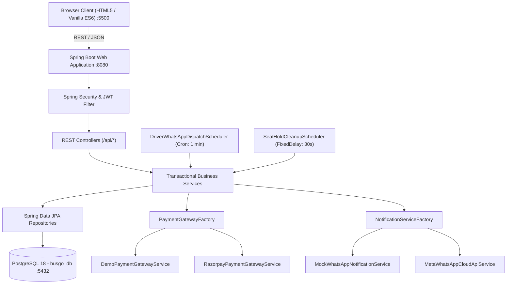

# BusGo — Architecture & Technical Design Specification

## 1. System Overview

BusGo is structured as a decoupled, multi-tier web application designed for high-availability intercity bus reservations.



---

## 2. Concurrency & Seat Booking Integrity

Bus ticket reservations face severe concurrency risks during peak booking windows (e.g., holiday eve departures). BusGo employs a **two-phase reservation architecture**:

### Phase 1: Temporary In-Memory / Database Hold (10-Minute Window)
- When a user selects 1 to 6 available seats and proceeds to checkout, `SeatHoldService` executes within a serializable transaction.
- It validates that none of the selected seats are currently booked or actively held by another customer.
- It generates a cryptographically random UUID `holdToken` and inserts rows into `seat_holds` with `expires_at = NOW() + 10 MINUTES`.
- If another concurrent transaction attempts to hold the same seat, a `SeatUnavailableException` (HTTP 409 Conflict) is thrown immediately.
- A background scheduler (`SeatHoldCleanupScheduler`) sweeps expired holds every 30 seconds, automatically returning abandoned seats to the available pool.

### Phase 2: Authoritative Database Booking with Constraint Enforcement
- Upon final payment confirmation, `BookingService` converts the held seats into permanent bookings within a single `@Transactional` method.
- The `booking_seats` table contains a unique database index:
  ```sql
  CREATE UNIQUE INDEX uq_active_schedule_seat 
  ON booking_seats (schedule_id, seat_number);
  ```
- Even if two concurrent requests bypass the hold layer due to race conditions or clock drift, the PostgreSQL database engine rejects the second transaction with a unique constraint violation, guaranteeing zero double-bookings.

---

## 3. Strict 3-Bus Operating Model

The application enforces a 3-bus operational ceiling to model the travel agency's initial operating fleet:
1. `TN-58-BG-1001`: 30-berth Multi-Axle AC Sleeper (2+1 Lower & Upper deck).
2. `TN-58-BG-1002`: 40-seat Executive AC Seater (2+2 single deck).
3. `TN-58-BG-1003`: 36-seat Premium AC Semi-Sleeper (2+2 single deck).

The `AdminService.createBus()` method explicitly evaluates `busRepository.count()` before registration. Any attempt to register a 4th bus throws a `BusinessValidationException`.

---

## 4. Driver WhatsApp Dispatch System (10 Minutes Prior to Departure)

In conventional systems, drivers are burdened with manually checking conductor apps. BusGo automates passenger onboarding via **direct WhatsApp push notifications to the assigned driver 10 minutes before trip departure**.

### Scheduling & Window Detection
1. The `@Scheduled(cron = "0 * * * * *")` worker runs every 60 seconds.
2. It calculates the target dispatch window:
   $$\text{Window Start} = \text{Current IST} + 9 \text{ minutes}$$
   $$\text{Window End} = \text{Current IST} + 11 \text{ minutes}$$
3. It identifies all scheduled trips departing within this 2-minute bracket.
4. For each schedule, it executes an **atomic idempotency check**:
   ```sql
   SELECT COUNT(*) FROM notification_logs 
   WHERE schedule_id = ? AND recipient_type = 'DRIVER' 
   AND delivery_status IN ('SENT', 'DELIVERED', 'MOCK_SENT');
   ```
5. If already dispatched, the trip is skipped, guaranteeing no duplicate spam to the driver.
6. The service formats a structured boarding manifest:
   - Trip ID & Route
   - Bus Registration & Coach Type
   - Departure Time & Pickup Terminal
   - Total Booked Passengers Count
   - Detailed seat-by-seat passenger roster (Seat Number, Passenger Name, Age, Gender, Primary Contact Phone).
7. Transmits the payload via `WhatsAppNotificationService`.

---

## 5. Security & Authentication Model

- **Stateless JWT**: Authentication uses RFC 7519 JSON Web Tokens signed with HMAC-SHA256 (`HS256`).
- **BCrypt Password Hashing**: Passwords are saved using BCrypt with a work factor of 12.
- **Role Isolation**:
  - `ROLE_CUSTOMER`: Permitted access to user endpoints (`/api/bookings/my`, `/api/holds`, `/api/trips/**`).
  - `ROLE_ADMIN`: Protected endpoints under `/api/admin/**`. Method-level annotations (`@PreAuthorize("hasRole('ADMIN')")`) enforce role integrity.
- **CORS Configuration**: Explicitly permits `http://localhost:5500` (and `http://127.0.0.1:5500`) with credential support and standard REST methods (`GET`, `POST`, `PUT`, `DELETE`, `OPTIONS`).
